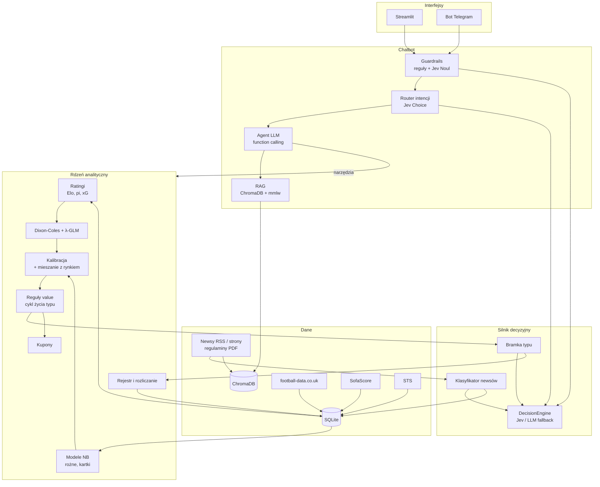
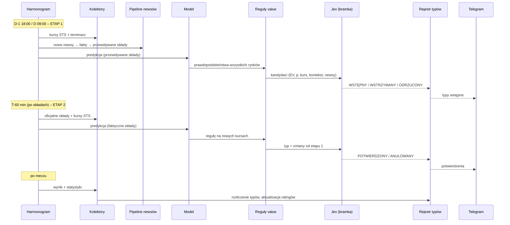
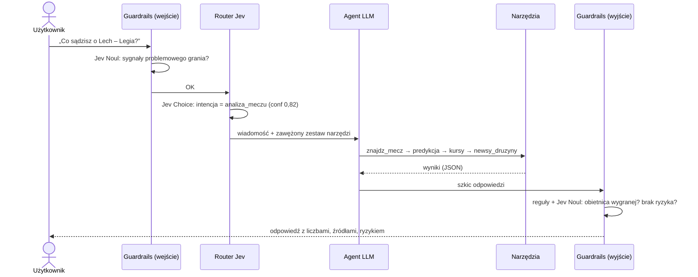

# 2. Architektura

## 2.1 Komponenty



| Komponent | Moduł | Opis | Rozdział |
|---|---|---|---|
| Kolektory danych | `typerai/collectors/` | import i scraping: football-data, SofaScore, STS, newsy | [3](03-dane.md) |
| Model predykcyjny | `typerai/model/` | ratingi, Dixon-Coles, λ-GLM, NB, kalibracja, rynki | [4](04-model-predykcyjny.md) |
| Pipeline newsów | `typerai/news/` | zbieranie, deduplikacja, klasyfikacja Jev, fakty, przewidywany skład | [5](05-newsy-i-wydarzenia.md) |
| Silnik decyzyjny | `typerai/decision/` | wspólny interfejs dla Jev i LLM, definicje pytań, polityki decyzji, log | [6](06-silnik-decyzyjny-jev.md) |
| Typy i decyzje | `typerai/betting/` | marża, EV, reguły, dwuetapowy cykl życia typu, stawki, kupony, rozliczanie | [7](07-typy-i-decyzje.md) |
| Chatbot | `typerai/chat/` | router, agent, narzędzia, RAG, guardrails, prompty | [8](08-chatbot-llm.md) |
| Interfejsy | `typerai/apps/` | Streamlit, Telegram | [9](09-interfejsy.md) |
| Ewaluacja | `evaluation/` | backtest, test na żywo, ocena NLP i Jev | [10](10-ewaluacja.md) |

## 2.2 Przepływ: dzień meczowy



## 2.3 Przepływ: pytanie w czacie



## 2.4 Harmonogram zadań

| Kiedy | Zadanie | Co robi |
|---|---|---|
| co 2 h (08:00–22:00) | `collect_news` | RSS → nowe artykuły → deduplikacja → klasyfikacja Jev → fakty → indeks RAG |
| codziennie 06:00 | `collect_fixtures` | terminarz na 10 dni (SofaScore), sędziowie, prognoza pogody dla meczów w ciągu 48 h |
| co 6 h | `collect_odds` | snapshot kursów STS i SofaScore dla meczów w ciągu 7 dni |
| D-1 18:00 i D 09:00 | `stage1_picks` | etap 1 dla meczów w ciągu 36 h, które nie mają jeszcze decyzji etapu 1 |
| co 10 min w dni meczowe | `stage2_watch` | dla meczów, które zaczynają się za 75–45 min: składy → etap 2 |
| T-5 min | `closing_odds` | ostatni snapshot kursów (do metryki CLV) |
| codziennie 23:30 | `settle` | wyniki i statystyki, rozliczenie typów, aktualizacja ratingów |
| poniedziałek 04:00 | `retrain` | ponowne dopasowanie modeli i kalibracji na pełnej historii |

Harmonogram obsługuje APScheduler w osobnym procesie (`python -m typerai.scheduler`). Każde uruchomienie zadania zapisuje wpis w tabeli `JOB_RUN` (start, koniec, status, błąd).

## 2.5 Struktura repozytorium

```
typer-ai/
├── README.md
├── docs/                          # ta dokumentacja
├── pyproject.toml
├── .env.example                   # nazwy zmiennych, bez wartości
├── data/
│   ├── raw/                       # surowe odpowiedzi źródeł (do ponownego przetworzenia)
│   ├── typer.db                   # SQLite
│   └── chroma/                    # baza wektorowa
├── typerai/
│   ├── config.py                  # ustawienia + progi (jeden plik, wersjonowany)
│   ├── db.py                      # schemat, migracje, dostęp
│   ├── markets.py                 # kody rynków i ich rozliczanie
│   ├── collectors/
│   │   ├── football_data.py
│   │   ├── sofascore.py           # mecze, statystyki, xG, składy, zawodnicy, sędziowie
│   │   ├── odds/
│   │   │   ├── base.py            # interfejs OddsAdapter
│   │   │   ├── sts.py
│   │   │   └── sofascore_odds.py
│   │   ├── weather.py             # prognoza pogody (Open-Meteo)
│   │   └── news_feeds.py
│   ├── model/
│   │   ├── ratings/{elo,pi,xg}.py
│   │   ├── dixon_coles.py
│   │   ├── lambda_glm.py          # korekta λ kowariantami
│   │   ├── features.py            # skład, zmęczenie, motywacja
│   │   ├── stats_markets.py       # NB: rożne, kartki
│   │   ├── score_matrix.py        # macierz wyników → rynki
│   │   ├── calibration.py
│   │   └── predict.py             # jeden punkt wejścia: predict(match_id, stage)
│   ├── news/
│   │   ├── pipeline.py
│   │   ├── dedup.py
│   │   ├── classify.py            # pytania do Jev
│   │   ├── facts.py
│   │   └── expected_lineup.py
│   ├── decision/
│   │   ├── engine.py              # DecisionEngine, JevEngine, LLMEngine
│   │   ├── questions/             # definicje pytań (YAML)
│   │   ├── policies.py            # kod zamieniający odpowiedzi na decyzje
│   │   └── log.py
│   ├── betting/
│   │   ├── odds_math.py           # marża, Shin
│   │   ├── value.py
│   │   ├── lifecycle.py           # etap 1 / etap 2
│   │   ├── staking.py
│   │   ├── coupon.py
│   │   └── settle.py
│   ├── chat/
│   │   ├── llm.py                 # LLMClient: Gemini, Groq, Bielik
│   │   ├── router.py
│   │   ├── agent.py
│   │   ├── tools.py
│   │   ├── rag.py
│   │   ├── guardrails.py
│   │   └── prompts/
│   ├── apps/{streamlit_app,telegram_bot}.py
│   └── scheduler.py
├── evaluation/
│   ├── backtest.py
│   ├── baselines.py
│   ├── live_report.py
│   ├── datasets/                  # zestawy oznaczone ręcznie (newsy, intencje, guardrails, pytania)
│   └── nlp_eval.py
└── tests/
```

## 2.6 Technologie

| Obszar | Technologia | Uzasadnienie |
|---|---|---|
| Język | Python 3.11+ | standard w NLP i ML |
| Dane | pandas, numpy, SQLite | proste, bez serwera bazy danych |
| Scraping | Playwright, httpx | SofaScore i STS wymagają przeglądarki lub zapytań do API strony |
| Pogoda | Open-Meteo API | darmowe, bez klucza |
| Newsy | feedparser, trafilatura | RSS + czysty tekst artykułu |
| Model | scipy (MLE), statsmodels (GLM Poissona, NB), scikit-learn (kalibracja) | dojrzałe, działają na CPU |
| Silnik decyzyjny | **Jev** przez `typesafe-sdk` | typowane decyzje z prawdopodobieństwami, szybko i tanio |
| Embeddingi | `sdadas/mmlw-retrieval-roberta-base` | model wyszukiwawczy dla polskiego, CPU |
| Baza wektorowa | ChromaDB | lokalna, z filtrowaniem po metadanych |
| LLM | Gemini (główny), Llama przez Groq, Bielik | porównanie modelu komercyjnego, otwartego i polskiego |
| Ewaluacja | RAGAS, scikit-learn metrics, własne skrypty | metryki NLP + bukmacherskie |
| UI | Streamlit, python-telegram-bot | szybki prototyp, czat na telefonie |
| Harmonogram | APScheduler | zadania cykliczne |
| Testy | pytest | testy jednostkowe matematyki kursów, rynków, parserów |

## 2.7 Konfiguracja i sekrety

- `.env` (poza repozytorium): `GEMINI_API_KEY`, `GROQ_API_KEY`, `TYPESAFE_API_KEY`, `TELEGRAM_BOT_TOKEN`, `TELEGRAM_ALLOWED_CHAT_IDS`, opcjonalnie `BIELIK_API_URL`.
- `typerai/config.py`: wszystkie progi (EV, prawdopodobieństwo, przedział kursów, progi Jev), wersje modeli, `DECISION_ENGINE=jev|llm`. Zmiana progu to commit w repozytorium, więc wiadomo, od kiedy obowiązuje.
- Każda predykcja i decyzja zapisuje `config_hash`, czyli skrót aktualnej konfiguracji.
