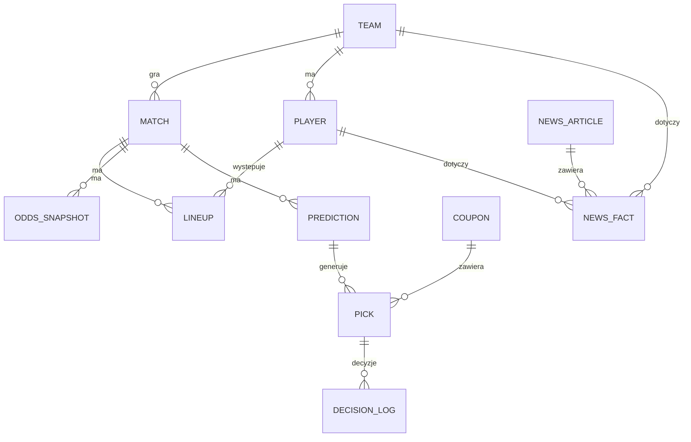

# 3. Dane

Projekt korzysta wyłącznie z **darmowych źródeł**, które pozwalają na automatyczne pobieranie danych. Nie obchodzimy zabezpieczeń stron (blokad botów, płatnego dostępu ani zakazów w `robots.txt`). Część źródeł planowanych na początku odpadła właśnie z tego powodu (3.2).

## 3.1 Źródła używane

| Źródło | Co daje | Zakres | Rola |
|---|---|---|---|
| **football-data.co.uk** (`new/POL.csv`) | wyniki i godziny meczów; kursy zamknięcia 1X2: Pinnacle (do połowy 2025/26), Betfair Exchange, Bet365, średnia, maksimum | Ekstraklasa od 2012/13, w tym bieżący sezon | Dixon-Coles, Elo, pi-ratings, tabela; backtest ROI 1X2; CLV w historii |
| **The Odds API** (darmowy plan, 500 kredytów/mies.) | bieżące kursy ok. 20 bukmacherów z regionu EU (m.in. Pinnacle, Betclic, Betfair, Unibet): 1X2, gole, handicap azjatycki; dla pojedynczych meczów także BTTS i podwójna szansa | od startu projektu | **kursy do decyzji** (najlepszy dostępny kurs), terminarz nadchodzących meczów, CLV na żywo względem Pinnacle |
| **90minut.pl** | relacje meczowe: pełne składy z minutami zmian, strzelcy, kartki, sędzia | wiele sezonów wstecz; bieżący sezon po każdym meczu | ważność zawodników, siła składu w historii, weryfikacja faktów z newsów |
| **Newsy** (RSS + strony) | artykuły o drużynach Ekstraklasy | od startu projektu | **główne przedmeczowe źródło informacji o nieobecnościach**, kontekst dla Jev, RAG |
| **Ręczne potwierdzenia** (formularz w aplikacji) | nieobecności sprawdzone przez użytkownika, np. ze składu ogłoszonego przez klub | opcjonalnie, dla meczów z kandydatem na typ | korekta przewidywanego składu w etapie 2; dane do oceny ekstrakcji z newsów |
| **Open-Meteo** | prognoza pogody dla stadionu | 48 h przed meczem | kontekst dla bramki Jev |
| **Regulaminy bukmacherów** (strony/PDF) | zasady rozliczania zakładów | stan bieżący | RAG |

### Kolumny `POL.csv` (zweryfikowane)

```
Country, League, Season, Date, Time, Home, Away, HG, AG, Res,
PSCH, PSCD, PSCA,       # Pinnacle, zamknięcie (brak od połowy sezonu 2025/26)
MaxCH, MaxCD, MaxCA,    # najwyższy kurs na rynku
AvgCH, AvgCD, AvgCA,    # średni kurs
BFECH, BFECD, BFECA,    # Betfair Exchange (ok. 700 ostatnich meczów)
B365CH, B365CD, B365CA  # Bet365
```

Godziny w pliku podane są w czasie brytyjskim, a w bazie zapisujemy je w UTC. Plik nie zawiera statystyk meczowych ani kursów na gole i handicap, dlatego **ROI w backteście liczymy tylko dla 1X2**. Pozostałe rynki oceniamy w backteście jakością prawdopodobieństw, a ROI liczymy w teście na żywo.

### Źródła newsów

Ostateczną listę ustalamy na etapie 3, sprawdzając dostępność RSS, `robots.txt` i regulamin każdego serwisu. Kategorie:
1. **oficjalne strony klubów**: najwyższa wiarygodność (komunikaty medyczne, konferencje),
2. **duże polskie portale sportowe**: najwięcej artykułów, w tym zapowiedzi meczów,
3. **serwisy regionalne**: wiadomości o mniejszych klubach.

Serwisy, które w `robots.txt` zabraniają dostępu botom (np. oficjalna strona ligi), pomijamy. Każde źródło ma w konfiguracji `wiarygodnosc ∈ {oficjalne, medialne}`.

## 3.2 Źródła sprawdzone i odrzucone

Wyniki testów z 1.11.2026:

| Źródło | Co sprawdziliśmy | Powód odrzucenia |
|---|---|---|
| **SofaScore** | statystyki, xG, składy, lista nieobecnych, kursy | zwykłe zapytania HTTP: kod 403. Przez przeglądarkę działało przez godzinę, potem odpowiedź `403 challenge`, czyli ochrona przed botami |
| **STS** | kursy | oferta przez wewnętrzny websocket, brak meczów w przeglądarce automatycznej, system ochrony przed botami |
| **Flashscore** | wyniki, składy | `robots.txt` blokuje listy meczów, a dane ładują się z zabezpieczonego kanału |
| **ekstraklasa.org** | składy, statystyki | `robots.txt` wprost zabrania dostępu botom AI i blokuje `/api/` |
| **API-Football** | statystyki, składy, kontuzje | darmowy plan obejmuje tylko sezony 2022–2024 (bez bieżącego), brak xG dla Ekstraklasy; płatny plan poza budżetem projektu |

**Konsekwencje dla projektu:**
- brak xG i statystyk strzałów, więc model opiera się na wynikach, ratingach i składach,
- brak oficjalnych składów przed meczem, więc przedmeczowe nieobecności pochodzą **z newsów (NLP)** i opcjonalnie z ręcznego potwierdzenia,
- brak kursów na rożne i kartki, więc te rynki są **poza zakresem**.

## 3.3 Kolektory

### 3.3.1 football-data (`collectors/football_data.py`)
Pobiera `POL.csv`, zapisuje kopię z datą w `data/raw/football_data/`, importuje mecze i kursy zamknięcia. Ponowne uruchomienie niczego nie dubluje. Uruchamiany codziennie (zadanie `collect_results`).

### 3.3.2 The Odds API (`collectors/odds_api.py`)
- `GET /events`: terminarz nadchodzących meczów, **bez kosztu**,
- `GET /odds?markets=h2h,totals,spreads&regions=eu`: snapshot rynków głównych wszystkich meczów naraz, **3 kredyty**,
- `GET /events/{id}/odds?markets=btts,double_chance`: rynki dodatkowe jednego meczu, **2 kredyty**, tylko w etapie 2 dla meczów z kandydatem na tych rynkach.

**Budżet kredytów (500 miesięcznie):**

| Zapytanie | Częstotliwość | Kredyty / mies. |
|---|---|---|
| snapshot rynków głównych | 2× dziennie | ok. 180 |
| snapshot przed etapem 2 | ok. 7 godzin rozpoczęcia na kolejkę × ok. 4,3 kolejki | ok. 90 |
| rynki dodatkowe | ok. 10 kandydatów miesięcznie | ok. 20 |
| zapas (testy, błędy) | – | ok. 210 |

Licznik pozostałych kredytów (`x-requests-remaining`) jest logowany przy każdym zapytaniu. Gdy spadnie poniżej 50, harmonogram ogranicza się do snapshotów przed etapem 2.

### 3.3.3 90minut.pl (`collectors/ninetymin.py`)
- **Zakres:** relacje meczowe Ekstraklasy z sezonów od 2015/16 do bieżącego, a w trakcie sezonu po każdej kolejce.
- **Dane:** składy (wyjściowa jedenastka i zmiany z minutą), strzelcy, żółte i czerwone kartki, sędzia.
- **Minuty zawodnika:** grający od początku ma 90 minut albo minutę zejścia. Rezerwowy ma `90 − minuta wejścia` (co najmniej 1). Strona nie podaje minuty czerwonej kartki, więc kartka nie skraca minut.
- **Zawodnicy** mają w serwisie stałe ID (`wystepy.php?id=…`), które przyjmujemy jako `PLAYER.id`, więc nie trzeba dopasowywać nazwisk między meczami.
- **Pozycja** wynika z kolejności w składzie (serwis wypisuje: bramkarz, obrońcy, pomocnicy, napastnicy): wiersz 1 = G, 2–5 = D, 6–9 = M, 10–11 = F. Pozycja zawodnika to najczęstsza wartość z jego występów w wyjściowym składzie.
- **Gole samobójcze** (ikona `own.gif`, dopisek „(s)”) nie są przypisywane zawodnikom. Kontrola jakości: suma goli zawodników i samobójczych musi się zgadzać z wynikiem meczu.
- **Zasady pobierania:** jedna strona na 3–5 s, każda relacja pobierana raz (cache surowego HTML w `data/raw/90minut/`), identyfikujący User-Agent z nazwą projektu. **Redakcja 90minut.pl wyraziła zgodę** na pobieranie danych do projektu (1.11.2026).
- **Dopasowanie do meczów:** data i para drużyn przez aliasy (`matches.find_match`).
- **Kodowanie:** strony są w ISO-8859-2, więc konwertujemy je do UTF-8 przed parsowaniem.

### 3.3.4 Kursy: adaptery i wybór kursu
Każde źródło kursów to adapter zwracający `OddsQuote(market, odds, bookmaker, taken_at)`. Do decyzji używamy **najlepszego kursu** danego zdarzenia spośród bukmacherów z ostatniego snapshotu (*line shopping*). Pinnacle zawsze zapisujemy osobno jako rynek referencyjny.

Przy wyborze najlepszego kursu odrzucamy:
- kursy **odstające** o więcej niż 8% od mediany wszystkich bukmacherów (prawdopodobny błąd w ofercie),
- bukmacherów z listy wykluczeń w konfiguracji (np. giełdy z prowizją, której kurs nie uwzględnia).

## 3.4 Kody rynków

| Rynek | Kod | Przykład | Rozliczenie |
|---|---|---|---|
| 1X2 | `1X2:{1\|X\|2}` | `1X2:1` | wynik meczu |
| Podwójna szansa | `DC:{1X\|X2\|12}` | `DC:X2` | wynik meczu |
| Gole powyżej/poniżej | `OU:{linia}:{over\|under}` | `OU:2.5:over` | suma goli vs linia; linie całkowite dają zwrot przy równości |
| Obie strzelą | `BTTS:{yes\|no}` | `BTTS:no` | gole obu drużyn |
| Handicap azjatycki | `AH:{linia}:{home\|away}` | `AH:-0.75:home` | linia z perspektywy typowanej drużyny; linie całkowite (zwrot), połówkowe, ćwiartkowe (stawka dzielona) |

Rozliczenie każdego kodu to funkcja `settle(market, hg, ag) -> Outcome ∈ {WIN, HALF_WIN, PUSH, HALF_LOSS, LOSS}`, z testami jednostkowymi wszystkich typów linii.

## 3.5 Schemat bazy (SQLite)



| Tabela | Kluczowe kolumny | Uwagi |
|---|---|---|
| `TEAM` | `id, name, aliases, stadium_lat, stadium_lon` | aliasy ze wszystkich źródeł |
| `MATCH` | `id, season, round, kickoff_utc, home_id, away_id, hg, ag, status, referee, source_ids` | jeden rekord łączy mecz ze wszystkich źródeł |
| `MATCH_STATS` | `match_id, yellow_h, yellow_a, red_h, red_a` | z 90minut.pl |
| `PLAYER` | `id, team_id, name, aliases, position` | własne ID; dopasowanie po nazwisku w obrębie kadry |
| `LINEUP` | `match_id, player_id, team_id, source (official\|expected\|manual), is_starter, weight, minutes, goals, created_at` | `official` z 90minut.pl po meczu; `expected` z newsów; `manual` z formularza |
| `ODDS_SNAPSHOT` | `match_id, market, odds, bookmaker, taken_at, is_closing` | tylko dopisywanie |
| `PREDICTION` | `id, match_id, stage, model_version, config_hash, as_of, features, probabilities` | niezmienne |
| `PICK` | `id, prediction_id, market, bookmaker, odds_stage1, odds_stage2, odds_closing, p_model, ev, status, outcome, profit` | cykl życia w rozdz. 7 |
| `DECISION_LOG` | `purpose, engine, model, state, questions, answers, decision, latency_ms, input_tokens` | każde zapytanie do Jev lub LLM |
| `NEWS_ARTICLE` | `url, source, reliability, published_at, title, text, simhash, duplicate_of` | |
| `NEWS_FACT` | `article_id?, source (news\|manual), team_id, player_id?, category, status?, impact, direction, certainty, valid_from, valid_until, superseded_by` | ręczne potwierdzenia jako fakty `source = manual` |
| `COUPON`, `JOB_RUN` | j.w. | |

## 3.6 Ujednolicenie nazw

Drużyny i zawodnicy występują w każdym źródle pod inną nazwą:
1. **drużyny:** słownik aliasów w `typerai/teams.py` (np. „Gornik Z.”, „Cracovia Kraków”, „Kolejorz”), sprawdzany testem na wszystkich nazwach z każdego źródła,
2. **zawodnicy:** normalizacja (małe litery, bez polskich znaków), potem dopasowanie rozmyte (`rapidfuzz`, próg 90) **w obrębie kadry danej drużyny**. W newsach często pada samo nazwisko, więc dopasowujemy też po nazwisku, jeśli jest jednoznaczne w kadrze,
3. **raport `unmatched.csv`:** nierozpoznane nazwy z każdego uruchomienia, do ręcznego uzupełnienia aliasów.

## 3.7 Zasady przeciwdziałania wyciekowi danych (data leakage)

1. **Predykcja w chwili `t` korzysta wyłącznie z danych dostępnych przed `t`**: wyników, składów, newsów opublikowanych przed `t`, kursów z `taken_at < t`. Funkcja `predict(match_id, stage, as_of=t)` filtruje wszystkie zapytania po `as_of`.
2. **Podział czasowy, nie losowy**: trening, walidacja i test to kolejne sezony (rozdz. 10).
3. **Strojenie tylko na walidacji**. Sezon testowy uruchamiamy raz, na końcu.
4. **Kursy zamknięcia nie są cechą decyzji**. Służą do oceny (CLV).
5. **Składy:** etap 1 i 2 używają składu przewidywanego (newsy i ręczne potwierdzenia). Skład oficjalny z 90minut.pl pojawia się dopiero po meczu i służy do treningu, ewaluacji i weryfikacji faktów.
6. **Ważność zawodników** liczona jest tylko z meczów przed `t`.

## 3.8 Harmonogram zbierania

| Zadanie | Kiedy | Źródło |
|---|---|---|
| `collect_results` | codziennie 08:00 | football-data |
| `collect_events` | codziennie 06:00 | The Odds API `/events` (bez kosztu) |
| `collect_odds` | 09:00 i 18:00 | The Odds API `/odds` |
| `collect_lineups` | codziennie 10:00 (relacje z poprzedniego dnia) | 90minut.pl |
| `collect_news` | co 2 h, 08:00–22:00 | RSS |
| `collect_weather` | codziennie 07:00, mecze w ciągu 48 h | Open-Meteo |

Kolektory zapisują surowe odpowiedzi w `data/raw/{źródło}/`, mają limity zapytań i ponawianie z wykładniczym odstępem. Każde uruchomienie trafia do `JOB_RUN`, a błędy wysyłane są alertem na Telegram.

## 3.9 Ryzyka związane z danymi

| Ryzyko | Skutek | Zabezpieczenie |
|---|---|---|
| Zmiana układu stron 90minut.pl | błędy parsera | testy parsera na zapisanych stronach, cache surowego HTML |
| Wyczerpanie kredytów The Odds API | brak kursów do końca miesiąca | budżet z 3.3.2, próg ostrzegawczy, ograniczanie snapshotów |
| football-data spóźnia się z wynikami | opóźnione rozliczenia | wyniki także z 90minut.pl |
| Mało newsów o nieobecnościach mniejszych klubów | słabszy przewidywany skład | strony klubów jako źródło, ręczne potwierdzenie |
| Mało meczów (ok. 306 na sezon) | duża niepewność | proste modele, regularyzacja, przedziały ufności |
