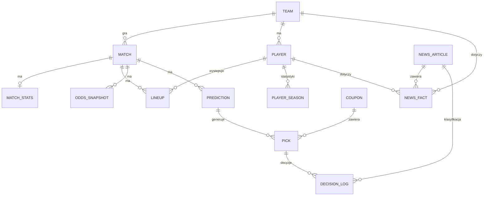

# 3. Dane

## 3.1 Źródła

| Źródło | Co daje | Zakres | Rola |
|---|---|---|---|
| **football-data.co.uk** (`new/POL.csv`) | wyniki, kursy 1X2 zamknięcia: Pinnacle, Bet365, Betfair, średnia, maksimum | Ekstraklasa od 2012/13 | długa historia do Dixon-Coles / Elo / pi-ratings, backtest ROI 1X2 i podwójnej szansy, CLV względem Pinnacle / Betfair Exchange |
| **SofaScore** (scraper) | terminarz, wyniki, statystyki (rożne, kartki, strzały, xG), składy i lista nieobecnych, statystyki zawodników, sędziowie | historia: ostatnie 4 sezony (xG od co najmniej 2022/23); bieżąco | xG-ratings, siła składu, modele NB, rozliczanie typów |
| **SofaScore – kursy** | kursy bet365 (dostawca kursów SofaScore dla Polski): 1X2, podwójna szansa, gole, BTTS, handicap azjatycki, rożne; **brak kartek** | od startu projektu | **kursy, na których podejmowane są decyzje** |
| **Open-Meteo** | prognoza pogody dla lokalizacji stadionu | 48 h przed meczem | kontekst dla bramki Jev (warunki meczu) |
| **Newsy** (RSS + strony) | artykuły o drużynach Ekstraklasy | od startu projektu | fakty, przewidywane składy, kontekst, RAG |
| **Regulaminy bukmacherów** (PDF/strona) | zasady rozliczania zakładów | stan bieżący | RAG |

### Kolumny `POL.csv` (zweryfikowane)

```
Country, League, Season, Date, Time, Home, Away, HG, AG, Res,
PSCH, PSCD, PSCA,       # Pinnacle, kursy zamknięcia (brak od połowy sezonu 2025/26)
MaxCH, MaxCD, MaxCA,    # najwyższy kurs na rynku
AvgCH, AvgCD, AvgCA,    # średni kurs
BFECH, BFECD, BFECA,    # Betfair Exchange
B365CH, B365CD, B365CA  # Bet365
```

Plik nie zawiera statystyk meczowych ani kursów na gole i handicap. Dlatego backtest ROI dla goli, handicapu, rożnych i kartek nie jest możliwy. Te rynki oceniamy w backteście trafnością i kalibracją, a ROI liczymy w teście na żywo na kursach bet365 z SofaScore.

### Źródła newsów

Ostateczną listę ustalamy na etapie 1, sprawdzając dostępność RSS i regulaminy serwisów. Kategorie źródeł:
1. **oficjalne strony klubów i ligi**: najwyższa wiarygodność (komunikaty medyczne, konferencje),
2. **duże polskie portale sportowe**: najwięcej artykułów, w tym zapowiedzi meczów,
3. **serwisy regionalne**: wiadomości o mniejszych klubach.

Każde źródło ma w konfiguracji `wiarygodnosc ∈ {oficjalne, medialne}`, wykorzystywaną przy scalaniu faktów (rozdz. 5).

## 3.2 Kolektor kursów: adaptery

Każdy bukmacher to osobny adapter z tym samym interfejsem:

```python
class OddsAdapter(Protocol):
    name: str                                   # "sofascore", w przyszłości kolejni bukmacherzy
    def list_events(self, league: str) -> list[BookEvent]: ...
    def get_odds(self, event: BookEvent) -> list[OddsQuote]: ...

@dataclass
class OddsQuote:
    market: str          # kod wewnętrzny, np. "OU:2.5:over"
    odds: float
    bookmaker: str
    taken_at: datetime
    raw_market_name: str # nazwa u bukmachera, do debugowania mapowania
```

Adapter odpowiada za:
1. dopasowanie wydarzenia u bukmachera do `MATCH.id` (nazwy drużyn przez aliasy, data ± 3 h),
2. mapowanie nazw rynków bukmachera na **kody wewnętrzne** (3.3),
3. odrzucenie rynków, których system nie obsługuje.

Dodanie kolejnego bukmachera (np. Fortuna, Superbet) oznacza napisanie jednej klasy. Reszta systemu wybiera wtedy najlepszy kurs spośród dostępnych.

**Dlaczego nie STS (test z 1.11.2026):** strona STS przesyła ofertę przez wewnętrzny websocket, w przeglądarce automatycznej nie wyświetla meczów, a działa na niej system ochrony przed botami. Projekt nie obchodzi takich zabezpieczeń, więc z STS zrezygnowaliśmy.

**Kursy z SofaScore:** dla Polski SofaScore pokazuje kursy bet365. O ile nam wiadomo, bet365 nie ma polskiej licencji (do sprawdzenia w rejestrze Ministerstwa Finansów). Dla projektu nie ma to znaczenia, bo stawki są wyłącznie wirtualne, a kursy bet365 traktujemy jako **kursy referencyjne rynku**. Interfejs adaptera pozwala później dodać kursy legalnego polskiego bukmachera, jeśli znajdzie się źródło dostępne bez obchodzenia zabezpieczeń.

### Wyniki testu źródeł (1.11.2026)

| Sprawdzenie | Wynik |
|---|---|
| SofaScore przez zwykłe zapytania HTTP | ❌ kod 403, potrzebna przeglądarka (Playwright), zapytania wysyłane z wnętrza strony |
| SofaScore: sezony Ekstraklasy | ✅ ID turnieju 202; sezony od 2019/20 i wcześniejsze |
| SofaScore: statystyki meczu | ✅ xG, rożne, kartki, strzały; **xG dostępne co najmniej od 2022/23** |
| SofaScore: składy | ✅ składy potwierdzone ok. godzinę przed meczem; **przed meczem dostępna lista nieobecnych** (`missingPlayers`) |
| SofaScore: kursy | ✅ bet365: 1X2, podwójna szansa, połowa, DNB, BTTS, gole (linie 0,5–6,5), handicap azjatycki, rożne; ❌ kartki |
| football-data: Pinnacle | ⚠️ brak od połowy 2025/26; Betfair Exchange dostępny w ok. 700 ostatnich meczach |
| STS | ❌ oferta niedostępna bez obchodzenia zabezpieczeń |

## 3.3 Kody rynków

Jeden format w całym systemie (model, reguły, kolektory, rozliczanie):

| Rynek | Kod | Przykład | Rozliczenie |
|---|---|---|---|
| 1X2 | `1X2:{1\|X\|2}` | `1X2:1` | wynik meczu |
| Podwójna szansa | `DC:{1X\|X2\|12}` | `DC:X2` | wynik meczu |
| Gole powyżej/poniżej | `OU:{linia}:{over\|under}` | `OU:2.5:over` | suma goli vs linia |
| Obie strzelą | `BTTS:{yes\|no}` | `BTTS:no` | gole obu drużyn |
| Handicap europejski | `EH:{h}:{1\|X\|2}` | `EH:-1:1` | wynik z doliczonym handicapem (3 wyniki) |
| Handicap azjatycki | `AH:{linia}:{home\|away}` | `AH:-0.75:home` | linie całkowite (zwrot), połówkowe, ćwiartkowe (stawka dzielona) |
| Rożne | `CRN:{linia}:{over\|under}` | `CRN:9.5:over` | suma rożnych |
| Kartki | `CRD:{linia}:{over\|under}` | `CRD:4.5:over` | suma żółtych kartek; czerwona = 2 (do weryfikacji w regulaminie bukmachera); **rynek tylko modelowany, bez typów** (brak kursów) |

Rozliczanie każdego kodu to jedna funkcja `settle(market, match_result) -> Outcome`. `Outcome` przyjmuje wartości `WIN`, `HALF_WIN`, `PUSH`, `HALF_LOSS`, `LOSS`. Funkcja ma testy jednostkowe dla wszystkich typów linii.

## 3.4 Schemat bazy (SQLite)



| Tabela | Kluczowe kolumny | Uwagi |
|---|---|---|
| `TEAM` | `id, name, aliases (JSON), stadium_lat, stadium_lon` | aliasy ze wszystkich źródeł, współrzędne do pogody |
| `MATCH` | `id, season, round, kickoff, home_id, away_id, hg, ag, status, referee, competition` | `competition` obejmuje też mecze pucharowe (Puchar Polski, europejskie puchary) do liczenia zmęczenia |
| `MATCH_STATS` | `match_id, xg_h, xg_a, corners_h, corners_a, yellow_h, yellow_a, red_h, red_a, shots_h, shots_a` | z SofaScore |
| `PLAYER` | `id, team_id, name, aliases, position` | |
| `PLAYER_SEASON` | `player_id, season, minutes, starts, goals, assists, xg, xa` | do indeksu ważności |
| `LINEUP` | `match_id, player_id, team_id, is_starter, minutes, source (expected\|official), created_at` | składy przewidywane i oficjalne |
| `ODDS_SNAPSHOT` | `match_id, market, odds, bookmaker, taken_at, is_closing` | nigdy nie nadpisujemy, tylko dopisujemy |
| `PREDICTION` | `id, match_id, stage (1\|2\|backtest), model_version, config_hash, created_at, features (JSON), probabilities (JSON)` | niezmienne |
| `PICK` | `id, prediction_id, market, odds, bookmaker, p_model, ev, status, stage1_at, stage2_at, odds_stage1, odds_stage2, result, profit` | cykl życia w rozdz. 7 |
| `DECISION_LOG` | `id, purpose, engine, model, state (JSON), questions (JSON), answers (JSON), decision, latency_ms, input_tokens, created_at` | każde zapytanie do Jev lub LLM-fallback |
| `NEWS_ARTICLE` | `id, url, source, reliability, published_at, fetched_at, title, text, simhash, duplicate_of` | |
| `NEWS_FACT` | `id, article_id, team_id, player_id?, category, status?, impact, direction, certainty, valid_from, valid_until, superseded_by` | rozdz. 5 |
| `COUPON` | `id, created_at, pick_ids, total_odds, p_total, ev, result` | |
| `JOB_RUN` | `job, started_at, finished_at, status, error` | diagnostyka harmonogramu |

## 3.5 Ujednolicenie nazw

Każde źródło zapisuje nazwy drużyn i zawodników inaczej, np. „Lech Poznan” / „Lech Poznań” / „Kolejorz”. Stosujemy:
1. **słownik aliasów** w `TEAM.aliases` i `PLAYER.aliases`, uzupełniany ręcznie dla drużyn,
2. **dopasowanie zawodników**: normalizacja (małe litery, bez polskich znaków), następnie dopasowanie rozmyte (`rapidfuzz`, próg 90) w obrębie kadry danej drużyny,
3. **test spójności**: skrypt sprawdza, czy każda drużyna i każdy zawodnik ze wszystkich źródeł ma przypisane ID. Nierozpoznane nazwy trafiają do raportu `unmatched.csv`.

## 3.6 Zasady przeciwdziałania wyciekowi danych (data leakage)

1. **Predykcja w chwili `t` korzysta wyłącznie z danych dostępnych przed `t`**: wyników, statystyk, składów, newsów opublikowanych przed `t`, kursów z `taken_at < t`. Funkcja `predict(match_id, stage, as_of=t)` filtruje wszystkie zapytania po `as_of`.
2. **Podział czasowy, nie losowy**: trening, walidacja i test to kolejne sezony (rozdz. 10).
3. **Strojenie tylko na walidacji**. Sezon testowy uruchamiamy raz, na końcu.
4. **Kursy zamknięcia nie są cechą decyzji**. Służą do oceny (CLV). Mieszanie z rynkiem w backteście używa kursu dostępnego w momencie decyzji, a dla historii z `POL.csv` (tylko zamknięcia) zaznaczamy to jako ograniczenie.
5. **Składy**: etap 1 używa wyłącznie składu przewidywanego, a etap 2 oficjalnego, opublikowanego przed `t`.
6. **Statystyki zawodników** (indeks ważności) liczone są tylko z meczów przed `t`.

## 3.7 Pipeline zbierania

| Etap | Skrypt | Wynik |
|---|---|---|
| Import historii | `collectors/football_data.py` | `MATCH` + `ODDS_SNAPSHOT` (zamknięcia 1X2) od 2012/13 |
| Historia SofaScore | `collectors/sofascore.py --history --seasons 4` | `MATCH_STATS`, `LINEUP (official)`, `PLAYER`, `PLAYER_SEASON`, sędziowie, mecze pucharowe drużyn |
| Bieżące mecze | `collectors/sofascore.py --upcoming` | nowe `MATCH`, sędziowie |
| Kursy | `collectors/odds/*.py` | `ODDS_SNAPSHOT` (co 6 h, przed etapem 2, zamknięcie) |
| Składy | `collectors/sofascore.py --lineups` | `LINEUP (official)` ok. 60 min przed meczem |
| Pogoda | `collectors/weather.py` | prognoza w `PREDICTION.features` (temperatura, opady, wiatr) |
| Wyniki | `collectors/sofascore.py --results` | uzupełnione `MATCH`, `MATCH_STATS`, `LINEUP.minutes` |
| Newsy | `news/pipeline.py` | `NEWS_ARTICLE`, `NEWS_FACT`, indeks ChromaDB, przewidywane składy |

Wszystkie kolektory:
- zapisują surowe odpowiedzi w `data/raw/{źródło}/{data}/`, żeby po zmianie parsera dało się je przetworzyć ponownie bez kolejnego pobierania,
- mają limit zapytań (1 na 1–2 s dla SofaScore) i ponawianie z wykładniczym odstępem,
- przy błędzie zapisują wpis w `JOB_RUN` i wysyłają alert na Telegram.

## 3.8 Ryzyka związane z danymi

| Ryzyko | Skutek | Zabezpieczenie |
|---|---|---|
| SofaScore zmieni format albo zablokuje dostęp | brak kursów, składów, statystyk | surowe dane, testy parserów na zapisanych odpowiedziach, adapter zapasowy (kursy SofaScore, API-Football) |
| Scraping niezgodny z regulaminem | problem prawny lub etyczny | niska częstotliwość, użytek edukacyjny, brak publikacji danych |
| Brak xG w starszych sezonach | krótsza historia xG | xG-ratings tylko dla dostępnych sezonów; model działa też bez nich (cecha opcjonalna) |
| Mało meczów (ok. 306 na sezon) | duża niepewność | proste modele, regularyzacja, przedziały ufności |
| Brak historycznych newsów | korekty z newsów nie da się sprawdzić w backteście | newsy wpływają tylko na **przewidywany skład** (backtest symuluje go z faktycznych nieobecności, rozdz. 10) i bramkę Jev (test na żywo) |
