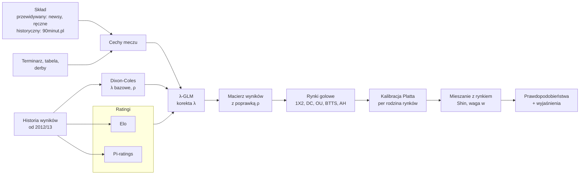

# 4. Model predykcyjny

Model ma jedno zadanie: dla każdego meczu i każdego etapu (1 lub 2) policzyć **dobrze skalibrowane prawdopodobieństwa** wszystkich obsługiwanych zdarzeń. Typy wybierane są dopiero na podstawie tych liczb (rozdz. 7). Ani LLM, ani Jev nie zmieniają prawdopodobieństw. Newsy wpływają na nie tylko w jeden, ściśle określony sposób: przez **przewidywany skład** w etapie 1 (4.4).

## 4.1 Przegląd



Pipeline działa w czterech krokach:
1. **Dixon-Coles** daje bazowe oczekiwane gole `λ` z długiej historii wyników.
2. **λ-GLM** koryguje `λ` o informacje, których Dixon-Coles nie widzi: ratingi, skład, zmęczenie, motywację.
3. **Macierz wyników** z poprawionych `λ` daje wszystkie rynki golowe w spójny sposób.
4. **Kalibracja** i **mieszanie z rynkiem** poprawiają jakość prawdopodobieństw.

## 4.2 Ratingi siły drużyn

### 4.2.1 Elo

- Oczekiwany wynik gospodarza: `E_h = 1 / (1 + 10^((R_a − R_h − HFA) / 400))`.
- Wynik rzeczywisty `S_h ∈ {1; 0,5; 0}`.
- Mnożnik za różnicę goli: `G = ln(|hg − ag| + 1) + 1`.
- Aktualizacja: `R_h ← R_h + K·G·(S_h − E_h)`, `R_a ← R_a − K·G·(S_h − E_h)`.
- Między sezonami: `R ← R − (R − 1500)/3` (częściowy powrót do średniej).
- Beniaminek startuje z ratingiem równym średniej drużyn, które spadły.
- Parametry strojone na walidacji: `K ∈ {15, 20, 25, 30}`, `HFA ∈ {40, 60, 80}`.

**Cecha:** `elo_diff = R_own − R_opp`.

### 4.2.2 Pi-ratings (Constantinou i Fenton, 2013)

Każda drużyna ma **dwa** ratingi: u siebie `R^H` i na wyjeździe `R^A`. Uwzględniają one, że część drużyn gra wyraźnie lepiej u siebie.

- Oczekiwana różnica goli drużyny o ratingu `R`: `ĝ(R) = sign(R)·(10^{|R|/3} − 1)`.
- Oczekiwana różnica goli meczu: `ĝ_D = ĝ(R_h^H) − ĝ(R_a^A)`.
- Błąd: `e = |(hg − ag) − ĝ_D|`, ważony `ψ(e) = 3·log10(1 + e)`, ze znakiem zgodnym z kierunkiem błędu.
- Aktualizacja gospodarza: `R_h^H += λ·ψ`, `R_h^A += γ·(zmiana R_h^H)`. Gość analogicznie, ze znakiem przeciwnym.
- Parametry startowe z publikacji: `λ = 0,035`, `γ = 0,7`. Strojenie na walidacji.

**Cecha:** `pi_diff = ĝ(R_own^{H|A}) − ĝ(R_opp^{A|H})`.

## 4.3 Dixon-Coles: bazowe λ

```
λ_h = exp(μ + h + atak_h − obrona_a)
λ_a = exp(μ + atak_a − obrona_h)
P(X=x, Y=y) = τ(x, y; λ_h, λ_a, ρ) · Pois(x; λ_h) · Pois(y; λ_a)
```

Poprawka `τ` dla niskich wyników:

| (x, y) | τ |
|---|---|
| (0, 0) | `1 − λ_h·λ_a·ρ` |
| (0, 1) | `1 + λ_h·ρ` |
| (1, 0) | `1 + λ_a·ρ` |
| (1, 1) | `1 − ρ` |
| pozostałe | 1 |

- **Estymacja:** największa wiarygodność z wagami czasowymi `w = exp(−ξ·dni_od_meczu)`, `scipy.optimize.minimize` (L-BFGS-B), ograniczenie `Σ atak = 0`.
- **Dane:** wszystkie mecze Ekstraklasy do chwili `as_of`. Ważenie czasem sprawia, że stare sezony mają znikomy wpływ.
- **Beniaminkowie:** parametry startowe równe średniej drużyn spadających, z regularyzacją L2 w kierunku tej średniej (λ_reg strojone).
- **Parametry strojone:** `ξ ∈ {0,0015; 0,0025; 0,0035; 0,005}` na dzień.

## 4.4 Cechy meczu

### 4.4.1 Siła składu (najważniejsza cecha „informacyjna”)

Dla każdego zawodnika liczymy na chwilę `as_of`, z ostatnich 10 meczów ligowych drużyny:
- `udzial_minut_i = minuty_i / (90 · liczba_meczów)`,
- `wklad_atak_i = gole_i na 90 min`, ściągane do średniej dla pozycji zawodnika przy małej liczbie minut: `(gole_i + 2·śr_poz) / (minuty_i/90 + 2)`. Asysty i xG nie są dostępne w darmowych źródłach,
- **skład referencyjny**: 11 zawodników z największą liczbą minut, z bramkarzem o największej liczbie minut.

Dla danego składu `S` (przewidywanego lub oficjalnego):

| Cecha | Definicja | Interpretacja |
|---|---|---|
| `lineup_att_ratio` | `Σ_{i∈S} wklad_atak_i · udzial_minut_i / Σ_{i∈ref} (to samo)` | 1,0 = pełna siła ofensywna |
| `lineup_reg_ratio` | `Σ_{i∈S} udzial_minut_i / Σ_{i∈ref} udzial_minut_i` | 1,0 = grają zawodnicy podstawowi |
| `gk_backup` | 1, jeśli w bramce nie gra bramkarz referencyjny | |

**Skład oficjalny (trening, backtest, ewaluacja):** z 90minut.pl, dostępny **po** meczu.

**Skład w etapie 2:** oficjalnych składów przed meczem nie pobieramy automatycznie (rozdz. 3.2). Przewidywany skład aktualizują więc newsy z ostatnich godzin (np. artykuły ze składami podanymi przez kluby) i opcjonalne **ręczne potwierdzenie** w aplikacji (`NEWS_FACT.source = manual`).

**Skład przewidywany (etap 1):**
1. start od składu referencyjnego,
2. usunięcie zawodników z aktywnymi faktami `status = out` (kontuzja, zawieszenie) z newsów (rozdz. 5) oraz z ręcznych potwierdzeń,
3. zawodnicy `doubtful` wchodzą do składu z wagą 0,5 (ich wkład liczony w połowie),
4. w miejsce usuniętego zawodnika wchodzi następny pod względem minut zawodnik **na tej samej pozycji**.

To jest **jedyna droga, którą newsy wpływają na liczby**. Współczynnik przy `lineup_*` jest wyuczony na historycznych składach oficjalnych, a nie ustawiony ręcznie, więc wpływ newsów jest ograniczony i uzasadniony danymi.

### 4.4.2 Zmęczenie i terminarz

| Cecha | Definicja |
|---|---|
| `rest_days` | dni od ostatniego meczu w dowolnych rozgrywkach (obcięte do 10) |
| `cup_midweek` | 1, jeśli drużyna grała mecz pucharowy (Puchar Polski, europejskie puchary; terminy z 90minut.pl) w ciągu 4 dni przed meczem |
| `cup_next` | 1, jeśli ma mecz pucharowy w ciągu 4 dni po meczu (ryzyko rotacji) |
| `travel_km` | odległość między stadionami / 100, tylko dla gościa |

### 4.4.3 Motywacja i kontekst (z tabeli, bez newsów)

Tabela jest liczona z wyników do chwili `as_of`:

| Cecha | Definicja |
|---|---|
| `releg_pressure` | `max(0, 1 − (pkt_nad_strefą_spadkową) / (3·kolejki_do_końca))`, 0 na początku sezonu |
| `title_euro_pressure` | analogicznie dla odległości do miejsc premiowanych (mistrzostwo, puchary) |
| `nothing_to_play` | 1, jeśli `kolejki_do_końca ≤ 5` i drużyna nie może już zmienić „strefy” (różnica punktów do obu granic > `3·kolejki_do_końca`) |
| `derby` | 1, jeśli para drużyn jest na liście derbów w `config.py` |

## 4.5 λ-GLM: korekta oczekiwanych goli

Regresja Poissona z **offsetem** równym logarytmowi λ z Dixon-Coles. Model uczy się więc tylko tego, czego Dixon-Coles nie wie.

Każdy mecz daje dwa wiersze, po jednym dla każdej drużyny jako „atakującej”:

```
gole_own ~ Poisson(λ)
log λ = log λ_DC_own + β · x
```

Wektor `x` (wszystkie cechy standaryzowane):

| Grupa | Cechy |
|---|---|
| ratingi | `elo_diff`, `pi_diff`, `goals_form_own` (wykładniczo ważona średnia goli, półokres 8 meczów) |
| skład | `lineup_att_ratio_own`, `lineup_reg_ratio_own`, `lineup_reg_ratio_opp`, `gk_backup_opp` |
| zmęczenie | `rest_days_own − rest_days_opp`, `cup_midweek_own`, `cup_midweek_opp`, `cup_next_own`, `travel_km` (gość) |
| motywacja | `releg_pressure_own`, `title_euro_pressure_own`, `nothing_to_play_own`, `nothing_to_play_opp`, `derby` |

- **Estymacja:** `statsmodels` GLM Poisson z regularyzacją L2 (`alpha` strojone) na sezonach ze składami z 90minut.pl (rozdz. 10).
- **Selekcja cech:** cecha zostaje w modelu, jeśli jej usunięcie pogarsza log-loss na walidacji. Wyniki ablacji trafiają do raportu.
- **Ograniczenie korekty:** `λ_final / λ_DC ∈ [0,75; 1,33]`, co chroni przed skrajnymi wartościami cech.
- **Wyjaśnialność:** składniki `β_k · x_k` zapisujemy w `PREDICTION.features`. Chatbot pokazuje 3 największe jako odpowiedź na pytanie „co wpłynęło na predykcję” (np. „brak Ishaka obniża oczekiwane gole Lecha o 7%”).

## 4.6 Od macierzy wyników do rynków

Z `λ_h`, `λ_a` (po korekcie) i `ρ` liczymy macierz `P[i, j]` dla `i, j ∈ 0..10` i normalizujemy ją do sumy 1.

| Rynek | Prawdopodobieństwo |
|---|---|
| `1X2:1 / X / 2` | `Σ_{i>j} P`, `Σ_{i=j} P`, `Σ_{i<j} P` |
| `DC:1X / X2 / 12` | sumy odpowiednich prawdopodobieństw 1X2 |
| `OU:L:over` | `Σ_{i+j>L} P` (linie połówkowe) |
| `BTTS:yes` | `Σ_{i≥1, j≥1} P` |
| `AH:L:home` | rozkład różnicy goli `d = i − j`; zamiast prawdopodobieństwa liczymy **oczekiwany zwrot** (4.6.1) |

### 4.6.1 Handicap azjatycki

Dla linii `L` i kursu `o`, wynik zakładu na gospodarza przy różnicy goli `d`:

| `d + L` | Wynik | Zysk przy stawce 1 |
|---|---|---|
| > 0 | wygrana | `o − 1` |
| = 0 | zwrot | 0 |
| < 0 | przegrana | −1 |

- Linie **ćwiartkowe** (np. −0,75) dzielą stawkę po połowie na dwie sąsiednie linie (−0,5 i −1,0).
- `EV(AH) = Σ_d P(d) · zysk(d, L, o)`.
- Do reguły „p ≥ próg” używamy **prawdopodobieństwa nieprzegrania** (wygrana + połowa zwrotów), opisanego w rozdz. 7.

## 4.7 Rynki statystyczne (poza zakresem)

Rożne i kartki były w pierwotnym planie. Odpadły, bo żadne darmowe źródło nie podaje na nie kursów ani bieżących statystyk (rozdz. 3.2). Model goli nie wymaga tych danych, a architektura pozwala dodać takie rynki później (model ujemny dwumianowy na liczbę zdarzeń).

## 4.8 Kalibracja

Kalibracja **Platta per rodzina rynków** (`1X2`, `DC`, `OU`, `BTTS`, `AH`):

```
p_cal = σ(a · logit(p) + b)
```

- Parametry `a`, `b` dopasowujemy na predykcjach **out-of-sample** z sezonu walidacyjnego (walk-forward).
- Dla 1X2: kalibracja jeden-przeciw-reszcie, potem normalizacja do sumy 1. Podwójną szansę liczymy z już skalibrowanego 1X2, żeby rynki były spójne.
- Izotoniczna regresja tylko dla rynku, który ma > 1500 predykcji walidacyjnych. Przy mniejszej liczbie grozi przeuczenie.
- **Kontrola:** wykres niezawodności (10 przedziałów) i ECE dla każdej rodziny rynków, w raporcie.

## 4.9 Mieszanie z rynkiem

Kurs bukmachera zawiera informacje, których model nie ma, np. nieopublikowane newsy albo pieniądze profesjonalnych graczy. Łączymy obie informacje w przestrzeni logitów:

```
p_final = σ( w · logit(p_cal) + (1 − w) · logit(p_rynek) )
```

- `p_rynek` to prawdopodobieństwo z kursów Pinnacle (a gdy ich brak, z mediany kursów bukmacherów) z The Odds API po usunięciu marży **metodą Shina** (rozdz. 7.1).
- `w ∈ [0, 1]` dobieramy per rodzina rynków na walidacji (siatka co 0,05), minimalizując log-loss.
- `w = 1` oznacza brak mieszania, a `w = 0` ślepe kopiowanie rynku. Typowo optymalne `w` wychodzi poniżej 0,5, a typ powstaje tylko tam, gdzie model **wyraźnie** nie zgadza się z rynkiem.
- **Ograniczenie backtestu:** dla historii są tylko kursy zamknięcia (`POL.csv`), niedostępne w momencie decyzji. Backtest raportujemy więc w dwóch wariantach: bez mieszania (wynik „czysty”) i z mieszaniem na kursach zamknięcia (górne oszacowanie, wyraźnie oznaczone).

## 4.10 Strojenie i wybór modelu

| Parametr | Siatka | Kryterium |
|---|---|---|
| Elo `K`, `HFA` | 4 × 3 | log-loss 1X2 na walidacji |
| pi-ratings `λ`, `γ` | {0,025; 0,035; 0,045} × {0,5; 0,7; 0,9} | j.w. |
| Dixon-Coles `ξ` | 4 wartości | log-loss wyników dokładnych |
| λ-GLM `alpha`, zestaw cech | 5 wartości + ablacja grup | log-loss 1X2 + OU 2.5 |
| mieszanie `w` | 0–1 co 0,05 | log-loss per rodzina |

- **Zasada:** modele wybieramy po **log-loss**, a nie po trafności ani ROI. Wybór po ROI na walidacji to prosta droga do przeuczenia.
- **Walk-forward na walidacji:** model dopasowywany co kolejkę na danych sprzed kolejki, tak jak w produkcji.
- Po wyborze parametrów konfiguracja jest **zamrażana** (`config_hash`) przed uruchomieniem testu.

## 4.11 Wyjście modelu

`predict(match_id, stage, as_of) -> Prediction`:

```json
{
  "match_id": 18234,
  "stage": 1,
  "model_version": "dc0.4-glm0.3-cal0.2-blend0.1",
  "as_of": "2026-11-08T09:00:00+01:00",
  "lambda": {"home": 1.62, "away": 1.08, "rho": -0.07},
  "probabilities": {
    "1X2:1": 0.497, "1X2:X": 0.262, "1X2:2": 0.241,
    "OU:2.5:over": 0.512, "BTTS:yes": 0.548
  },
  "lineup": {"home": {"type": "expected", "att_ratio": 0.93, "reg_ratio": 0.95},
             "away": {"type": "expected", "att_ratio": 1.00, "reg_ratio": 0.98}},
  "top_contributions": [
    {"feature": "lineup_att_ratio_home", "effect_on_lambda_home": -0.07},
    {"feature": "cup_midweek_away", "effect_on_lambda_away": -0.04},
    {"feature": "pi_diff", "effect_on_lambda_home": 0.05}
  ]
}
```

Liczby w przykładzie są ilustracyjne. Wyjście trafia do tabeli `PREDICTION` i jest niezmienne.

## 4.12 Wersjonowanie

`model_version` składa się z wersji wszystkich komponentów, np. `dc0.4-glm0.3-cal0.2-blend0.1`. Każda zmiana kodu modelu podnosi wersję komponentu. W raportach typy grupujemy według wersji, żeby nie mieszać wyników różnych modeli.
