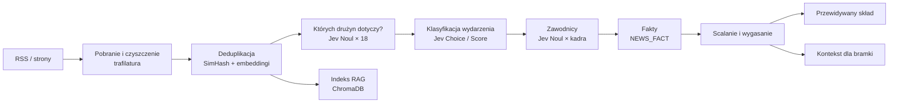

# 5. Newsy i wydarzenia

## 5.1 Rola newsów w projekcie

Newsy mają **celowo ograniczoną** rolę. Wpływają na system tylko na trzy sposoby:

| # | Droga wpływu | Kiedy | Siła wpływu |
|---|---|---|---|
| 1 | **Przewidywany skład** (kontuzje, zawieszenia, powroty) → cechy `lineup_*` w modelu | tylko etap 1; w etapie 2 zastępuje go oficjalny skład | ograniczona współczynnikiem wyuczonym na historii i limitem λ ∈ [0,75; 1,33] |
| 2 | **Kontekst dla bramki Jev** (wszystkie kategorie) | etap 1 i 2 | **tylko weto**: Jev może wstrzymać lub odrzucić typ, nigdy go nie dodaje |
| 3 | **RAG w czacie** | zawsze | brak wpływu na typy; odpowiedzi na pytania użytkownika |

Newsy **nigdy bezpośrednio nie podnoszą** prawdopodobieństwa ani nie tworzą typu.

## 5.2 Pipeline



Zadanie `collect_news` uruchamia się co 2 godziny w godzinach 8:00–22:00.

### Krok 1: pobranie i czyszczenie
- `feedparser` czyta kanały RSS z listy źródeł (`config.NEWS_SOURCES`).
- Dla nowych URL-i `trafilatura` pobiera czysty tekst artykułu bez menu, reklam i komentarzy.
- Odrzucamy artykuły krótsze niż 300 znaków i starsze niż 7 dni.
- Zapis do `NEWS_ARTICLE` (tytuł, tekst, źródło, wiarygodność, `published_at`).

### Krok 2: deduplikacja
Ta sama informacja pojawia się w wielu serwisach. Duplikaty wykrywamy dwustopniowo:
1. **SimHash** tekstu: odległość Hamminga ≤ 3 oznacza duplikat,
2. **embeddingi** (`mmlw-retrieval-roberta-base`): podobieństwo kosinusowe ≥ 0,92 z artykułem z ostatnich 48 h oznacza duplikat.

Duplikat dostaje `duplicate_of`. Nie jest klasyfikowany ponownie, ale **podnosi pewność** faktów oryginału (5.5).

### Krok 3: których drużyn dotyczy artykuł
Dla każdej z 18 drużyn Ekstraklasy wysyłamy jedno pytanie **Noul** do Jev. Wszystkie pytania idą w jednym zapytaniu i są oceniane równolegle:

```json
"about_lech": {
  "type": "noul",
  "instructions": "Does this article report news about the football club Lech Poznań (players, coach, club situation or an upcoming match)? Mentions only in passing do not count."
}
```

- Drużyna jest „dotyczona”, gdy `noul ≥ 0,6`.
- Pre-filtr: pytanie wysyłamy tylko dla drużyn, których nazwa lub alias występuje w tekście. Zmniejsza to koszt i liczbę fałszywych trafień.

### Krok 4: klasyfikacja wydarzenia
Dla każdej dotyczonej drużyny jedno zapytanie do Jev. W `state` jest artykuł i drużyna, na której model ma się skupić:

```json
{
  "focus_team": "Lech Poznań",
  "title": "...",
  "text": "...",
  "published_at": "2026-11-06"
}
```

Pytania:

```json
{
  "category": {
    "type": "choice",
    "instructions": "What is the main event reported about the focus team?",
    "criteria": {
      "injury": "A player is injured or recovering from injury",
      "suspension": "A player is suspended (cards, disciplinary decision)",
      "return": "A player returns from injury or suspension and is available",
      "coach_change": "Coach dismissed, appointed, or coach position under threat",
      "club_crisis": "Financial problems, unpaid wages, internal conflict, ownership turmoil",
      "fatigue_schedule": "Congested schedule, travel, cup matches, squad rotation",
      "motivation_context": "Stakes of the match: derby, relegation fight, title race, nothing to play for",
      "match_conditions": "Weather, pitch condition, stadium closure, match without fans",
      "transfer": "Transfer in or out, contract news",
      "other": "Anything else (preview without new facts, interviews, history)"
    }
  },
  "impact": {
    "type": "score",
    "instructions": "How much could this event affect the focus team's performance in its next league match?",
    "criteria": [
      "No effect on the next match",
      "Marginal effect (fringe player, minor issue)",
      "Small effect (rotation player, minor disruption)",
      "Moderate effect (regular starter, noticeable disruption)",
      "Large effect (key player or major disruption of the whole team)"
    ]
  },
  "direction": {
    "type": "choice",
    "instructions": "For the focus team's next match, does this event weaken or strengthen the team?",
    "criteria": {"weakens": "Makes the team weaker", "strengthens": "Makes the team stronger", "neutral": "No clear effect"}
  },
  "certainty": {
    "type": "choice",
    "instructions": "How certain is the reported information?",
    "criteria": {
      "official": "Confirmed by the club, coach or league",
      "reported": "Reported by media as fact, not officially confirmed",
      "speculation": "Rumour, possibility or speculation"
    }
  }
}
```

Instrukcje i kryteria piszemy **po angielsku**, bo dla tego języka Jev ma najlepszą dokładność. Treść artykułu zostaje po polsku. Wariant z polskimi instrukcjami porównujemy na zbiorze testowym (rozdz. 10).

### Krok 5: zawodnicy
Tylko dla kategorii `injury`, `suspension` i `return`. Dla każdego zawodnika z aktualnej kadry drużyny (ok. 25–35 osób) wysyłamy jedno pytanie Noul:

```json
"p_12345": {
  "type": "noul",
  "instructions": "Does the article state that Mikael Ishak (Lech Poznań) will miss or may miss the next match?"
}
```

Dla `return` instrukcja brzmi: „…is available again after injury or suspension?”. Do tego dla każdego wskazanego zawodnika:

```json
"status_12345": {
  "type": "choice",
  "instructions": "What is the availability status of Mikael Ishak for the next match?",
  "criteria": {"out": "Will not play", "doubtful": "Uncertain whether he will play", "available": "Will be available"}
}
```

Zawodnik zostaje przypisany do faktu, gdy `noul ≥ 0,7`.

**Dlaczego pytania o każdego zawodnika, a nie generowanie nazwisk przez LLM:** Jev wybiera wyłącznie z listy kadry, więc nie może „zmyślić” zawodnika. Od razu też dostajemy ID z bazy i nie trzeba rozmyto dopasowywać nazwisk.

## 5.3 Taksonomia wydarzeń i ich wykorzystanie

| Kategoria | Przykład | Przewidywany skład | Bramka Jev | Domyślny czas ważności |
|---|---|---|---|---|
| `injury` | „Ishak nie zagra z Legią” | ✅ usunięcie lub `doubtful` | ✅ | do `expected_return` lub 14 dni |
| `suspension` | „Pauza za kartki” | ✅ usunięcie | ✅ | do następnego meczu ligowego |
| `return` | „Wraca po kontuzji” | ✅ przywrócenie | ✅ | do następnego meczu |
| `coach_change` | „Trener zwolniony” | – | ✅ | 21 dni |
| `club_crisis` | „Zaległe pensje” | – | ✅ | 14 dni |
| `fatigue_schedule` | „Rotacja przed pucharem” | – (zmęczenie liczy model z terminarza) | ✅ | do następnego meczu |
| `motivation_context` | „Mecz o utrzymanie” | – (motywację liczy model z tabeli) | ✅ | do następnego meczu |
| `match_conditions` | „Ulewa, grząska murawa”, „mecz bez kibiców” | – | ✅ | do następnego meczu |
| `transfer` | „Nowy napastnik” | – (kadrę aktualizuje SofaScore) | – | – |
| `other` | wywiad, historia | – | – | – (tylko RAG) |

Fakty o `impact = 0` (brak wpływu) nie trafiają do bramki. Zostają tylko w RAG.

## 5.4 Fakt: struktura

```json
{
  "id": 4412,
  "article_id": 9981,
  "team_id": 3,
  "player_id": 12345,
  "category": "injury",
  "status": "out",
  "impact": 3.2,
  "direction": "weakens",
  "certainty": "reported",
  "valid_from": "2026-11-06T10:15:00+01:00",
  "valid_until": "2026-11-20T00:00:00+01:00",
  "sources": [9981, 9987],
  "superseded_by": null
}
```

`impact` to `score` z Jev (0–4, może być ułamkiem). Pole `certainty` może zostać podniesione przy scalaniu, jeśli kilka niezależnych źródeł potwierdza ten sam fakt.

## 5.5 Scalanie i wygasanie faktów

1. **Ten sam zawodnik, ta sama kategoria:** obowiązuje najnowszy fakt, a starszy dostaje `superseded_by`.
2. **Sprzeczność** (`out` w jednym źródle, `available` w drugim): wygrywa fakt o wyższej pewności (`official > reported > speculation`), a przy równej pewności nowszy.
3. **Potwierdzenia:** duplikat z innego źródła albo kolejny artykuł z tym samym faktem podnosi `certainty` z `speculation` na `reported`. Źródło oficjalne podnosi ją na `official`.
4. **Wygasanie:** po `valid_until` (tabela 5.3) albo po rozegraniu meczu, którego fakt dotyczył (zawieszenia, zmęczenie, warunki).
5. **Weryfikacja przez skład:** po meczu porównujemy fakty `out` z oficjalnym składem. Zawodnik, który zagrał mimo faktu `out`, oznacza błędny fakt. Te dane trafiają do ewaluacji (rozdz. 10).

**Wpływ pewności na przewidywany skład:**

| `certainty` | `status = out` | `status = doubtful` |
|---|---|---|
| `official` | usunięty | waga 0,5 |
| `reported` | usunięty | waga 0,5 |
| `speculation` | waga 0,5 | bez zmian |

## 5.6 Kontekst dla bramki decyzyjnej

Dla każdego meczu budujemy zwięzły opis aktywnych faktów obu drużyn, przekazywany do Jev w `state` (rozdz. 6):

```json
"news_context": {
  "home": [
    {"category": "injury", "player": "Mikael Ishak", "status": "out", "impact": 3.2, "certainty": "reported", "age_hours": 30},
    {"category": "fatigue_schedule", "impact": 1.8, "certainty": "reported", "summary_title": "Lech po meczu w Lidze Konferencji"}
  ],
  "away": [
    {"category": "coach_change", "impact": 2.6, "certainty": "official", "age_hours": 96, "summary_title": "Nowy trener Legii"}
  ]
}
```

Pole `summary_title` to oryginalny tytuł artykułu, a nie tekst generowany. Do bramki trafia maksymalnie 5 faktów na drużynę, posortowanych po `impact`.

## 5.7 Indeks RAG

Każdy artykuł (także duplikaty i kategoria `other`) trafia do ChromaDB. Chunking, embeddingi i wyszukiwanie opisuje rozdz. 8.4. Metadane chunka: `team_ids`, `category`, `published_at`, `source`, `url`, `fact_ids`.

## 5.8 Plan B bez Jev

Jeśli API Jev będzie niedostępne, te same pytania (Noul, Choice, Score) obsługuje `LLMEngine` (rozdz. 6.6). LLM zwraca JSON z prawdopodobieństwami w identycznym formacie, więc reszta pipeline'u się nie zmienia. Porównanie obu silników to jeden z eksperymentów (rozdz. 10).
