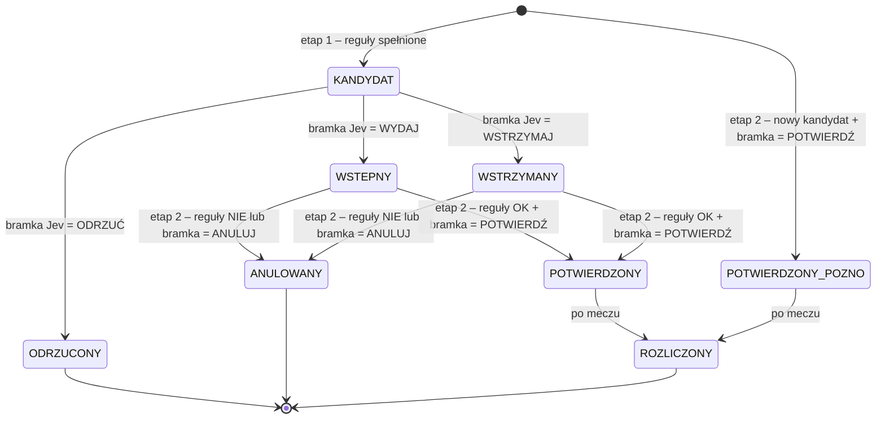

# 7. Typy i decyzje

Rozdział opisuje drogę od prawdopodobieństw modelu do typu: usuwanie marży, wartość oczekiwaną, reguły wyboru, dwuetapowy cykl życia typu, stawki, kupony i rozliczanie.

## 7.1 Kursy i marża

Kursy `o_1, …, o_n` jednego rynku (np. 1, X, 2) dają surowe prawdopodobieństwa `π_k = 1/o_k`. Ich suma przekracza 1, a nadwyżka to marża:

```
marża = Σ π_k − 1
```

**Metoda proporcjonalna** (prosta, do wyjaśnień w czacie):
```
p_k = π_k / Σ π_l
```

**Metoda Shina** (domyślna w modelu). Uwzględnia, że bukmacher zawyża marżę głównie na outsiderach (*favourite-longshot bias*). Szukamy `z ∈ [0, 0,2)`, dla którego:
```
p_k(z) = ( sqrt(z² + 4(1 − z) · π_k² / Σπ) − z ) / ( 2(1 − z) ),   Σ p_k(z) = 1
```
Rozwiązujemy to numerycznie metodą bisekcji. Dla rynków dwuwynikowych (OU, BTTS, AH) obie metody dają podobny wynik.

## 7.2 Wartość oczekiwana

Przy stawce 1 jednostki:

```
EV = p_final · o − 1
```

Dla handicapu azjatyckiego EV liczymy z rozkładu różnicy goli (rozdz. 4.6.1). Prawdopodobieństwo używane w regule `p ≥ próg` to wtedy:
```
p_AH = P(wygrana) + P(połowa wygranej) + ½ · P(zwrot)
```

**Kurs do decyzji:** **najlepszy kurs** danego zdarzenia spośród bukmacherów z ostatniego snapshotu The Odds API, nie starszego niż 2 h (etap 1) lub 15 min (etap 2), z odrzuceniem kursów odstających o więcej niż 8% od mediany (rozdz. 3.3.4). Jeśli dla rynku nie ma kursu, typu nie ma. Zapisujemy też bukmachera, u którego kurs był najlepszy.

## 7.3 Reguły wyboru typów

Kandydat to para (mecz, rynek), która spełnia **wszystkie** reguły:

| # | Reguła | Wartość startowa | Cel |
|---|---|---|---|
| R1 | `EV ≥ EV_min` | 0,03 | przewaga nad rynkiem → ROI > 0 |
| R2 | `p_final ≥ p_min` | 0,52 | zapas ponad 50% na błąd kalibracji → trafność > 50% |
| R3 | `o_min ≤ kurs ≤ o_max` | 1,50 – 2,30 | razem z R2 wymusza rozsądne value; wyklucza „pułapki” niskich kursów |
| R4 | `EV ≤ EV_max` | 0,25 | podejrzanie duże EV zwykle oznacza błąd danych (zły skład, zła linia) |
| R5 | drużyny mają ≥ 5 meczów ligowych w bazie w bieżącym sezonie lub w poprzednim w Ekstraklasie | – | brak typów przy niepewnym modelu |
| R6 | rynek ma `w < 1` i log-loss na walidacji lepszy niż rynek | – | typujemy tylko rynki, na których model wykazał wartość |
| R7 | kurs aktualny (2 h / 15 min) | – | brak decyzji na nieaktualnych kursach |

Gdy mecz ma kilku kandydatów, wybieramy **jednego**:
1. najwyższe `EV · p_final` (kompromis między przewagą a trafnością),
2. przy remisie wyższe `p_final`.

Typy z jednego meczu są silnie skorelowane, a jeden typ na mecz upraszcza też ewaluację.

**Strojenie** (`EV_min ∈ {0,02; 0,03; 0,05; 0,08}`, `p_min ∈ {0,50; 0,52; 0,55}`, `o_max ∈ {2,10; 2,30; 2,50}`) odbywa się na **walidacji**. Kryterium to ROI z zastrzeżeniem minimalnej liczby typów (≥ 40). Wynik doboru zapisujemy, a progi zamrażamy przed testem.

Reguły R2 i R3 wspólnie przekładają się na cel projektu. Przy `p ≥ 0,52` i dobrej kalibracji oczekiwana trafność przekracza 50%. Przy `EV ≥ 3%` oczekiwany zysk jest dodatni.

## 7.4 Dwuetapowy cykl życia typu



### Etap 1: typ wstępny
- **Kiedy:** D-1 o 18:00 i D o 09:00, dla meczów w ciągu 36 h bez decyzji etapu 1.
- **Wejście:** predykcja `stage=1` (skład przewidywany z newsów), aktualne kursy.
- **Wyjście:** status `WSTEPNY`, `WSTRZYMANY` lub `ODRZUCONY`, `odds_stage1`, powiadomienie na Telegram o typach wstępnych.
- **Znaczenie dla użytkownika:** „model widzi wartość, ale czekamy na składy”. Kto chce, może zawrzeć zakład wcześniej po lepszym kursie, świadomie ponosząc ryzyko składu.

### Etap 2: potwierdzenie
- **Kiedy:** ok. 60 min przed meczem (zadanie `stage2_watch` co 10 min wybiera mecze zaczynające się za 50–70 min). Wcześniej pobierane są najnowsze newsy, a użytkownik dostaje na Telegram prośbę o opcjonalne ręczne potwierdzenie nieobecności (np. po sprawdzeniu składu ogłoszonego przez klub).
- **Wejście:** predykcja `stage=2` (skład przewidywany z najnowszych newsów i ręcznych potwierdzeń), kursy z ostatnich 15 min, wynik etapu 1, ruch kursu.
- **Dla typu `WSTEPNY` lub `WSTRZYMANY`:** ponowne sprawdzenie reguł R1–R7 na nowych liczbach, potem bramka Jev. Typ staje się `POTWIERDZONY` albo `ANULOWANY`.
- **Nowi kandydaci** (np. dopiero skład pokazał wartość): mogą dostać status `POTWIERDZONY_POZNO`, oznaczany osobno w raportach.
- **Niepewność składu:** jeśli bramka Jev uzna informacje o składzie za niepotwierdzone (`uncertainty ≥ 0,60`), typ jest anulowany (reguła „brak informacji = brak typu”).

### Typ oficjalny

**Oficjalny wynik typera** to typy `POTWIERDZONY` i `POTWIERDZONY_POZNO`, rozliczane po **kursie z etapu 2** (`odds_stage2`). Na nich mierzymy cel C2 (trafność > 50%, ROI > 0).

Dodatkowo raportujemy strategie pomocnicze, które pokazują wartość informacji i timingu:

| Strategia | Typy | Kurs | Co pokazuje |
|---|---|---|---|
| **S2-OFICJALNA** | potwierdzone | etap 2 | wynik systemu |
| S1-WSZYSTKIE | wstępne | etap 1 | czy warto obstawiać wcześnie, bez czekania na składy |
| S1-POTWIERDZONE | wstępne, później potwierdzone | etap 1 | górna granica: wczesny kurs + pełna informacja (nierealna w praktyce) |
| S-NOGATE | spełniające reguły w etapie 2, bez bramki | etap 2 | wartość bramki Jev (rozdz. 6.5.1) |

## 7.5 Stawki

- **Ewaluacja:** zawsze **stała stawka 1 jednostka**, żeby ROI było porównywalne.
- **W interfejsie (informacyjnie):** ułamkowe kryterium Kelly'ego:
  ```
  f = ¼ · (p·o − 1) / (o − 1),  z limitem 2% wirtualnego budżetu
  ```
  Ćwiartka Kelly'ego ogranicza ryzyko błędu modelu: pełny Kelly przy przeszacowanym `p` szybko prowadzi do dużych strat.

## 7.6 Kupony

Kupon (AKO) to iloczyn kursów, ale też **iloczyn marż**, więc ryzyko szybko rośnie. Zasady:

- kupon składamy **wyłącznie z typów potwierdzonych** (lub wstępnych, jeśli użytkownik prosi o kupon przed składami, z wyraźnym oznaczeniem),
- 2–3 zdarzenia, każde z innego meczu,
- `p_kupon = Π p_k` (różne mecze traktujemy jako niezależne), `EV_kupon = p_kupon · Π o_k − 1`,
- **algorytm:** przegląd wszystkich kombinacji 2–3 typów z dostępnej puli (pula ≤ 15, więc najwyżej 455 kombinacji). Wybieramy kombinację o najwyższym `EV_kupon`, której łączny kurs mieści się w ±20% kursu docelowego podanego przez użytkownika,
- skuteczność kuponów raportujemy **osobno**. Cel C2 dotyczy typów pojedynczych,
- chatbot zawsze pokazuje `p_kupon`. Przykład: trzy typy po 0,55 to łącznie tylko ok. 17%.

## 7.7 Rozliczanie

Po meczu zadanie `settle`:
1. pobiera wynik (football-data) i skład z minutami (90minut.pl),
2. dla każdego typu wywołuje `settle(market, result) → Outcome` (rozdz. 3.3),
3. liczy zysk:

| Outcome | Zysk przy stawce 1 |
|---|---|
| `WIN` | `o − 1` |
| `HALF_WIN` | `(o − 1) / 2` |
| `PUSH` | 0 |
| `HALF_LOSS` | −0,5 |
| `LOSS` | −1 |

4. zapisuje kurs zamknięcia (ostatni snapshot przed meczem) do obliczenia CLV,
5. aktualizuje ratingi (Elo, pi) i ważność zawodników,
6. weryfikuje fakty z newsów względem składu (rozdz. 5.5),
7. wysyła podsumowanie dnia na Telegram.

Mecz przełożony lub przerwany rozliczamy według typowych zasad bukmacherskich (zwykle zwrot, czyli `PUSH`). Wyjątki obsługujemy ręcznie i oznaczamy w bazie.

## 7.8 Format typu (dla chatbota i Telegrama)

```json
{
  "pick_id": 771,
  "status": "POTWIERDZONY",
  "match": "Lech Poznań – Legia Warszawa, 08.11 17:30",
  "market": "1X2:1",
  "label": "Wygrana Lecha",
  "odds": 2.15,
  "bookmaker": "betclic (najlepszy kurs z 18)",
  "p_model": 0.531,
  "p_market": 0.447,
  "ev": 0.142,
  "kelly_info_pct": 1.2,
  "reasons": ["pi_diff +0,05 do λ gospodarzy", "Legia bez 2 podstawowych obrońców (newsy + ręczne potwierdzenie)"],
  "gate": {"decision": "issue", "context_risk": 0.8, "contradiction": 0.12},
  "risk_note": "Model daje ok. 53% szans – typ przegra mniej więcej w 47 na 100 podobnych przypadków."
}
```

Liczby w przykładzie są ilustracyjne.
